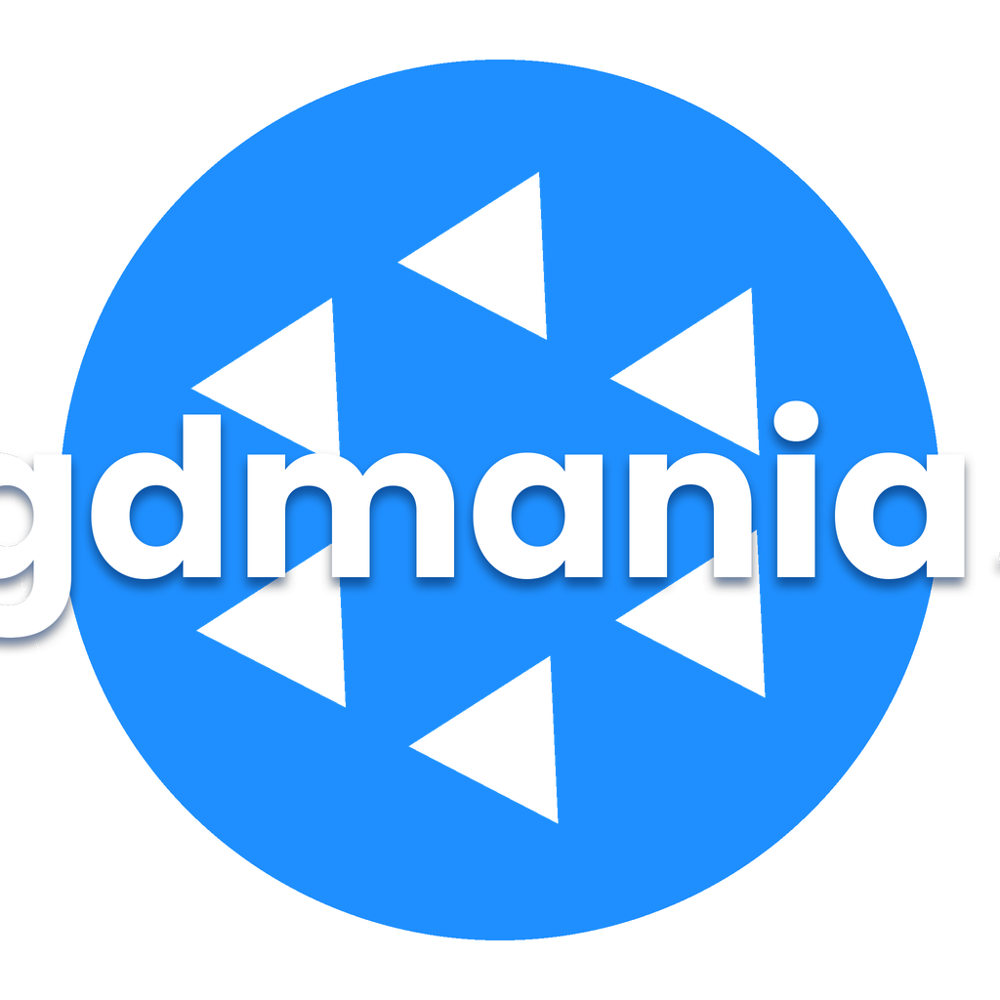

# gdmania!

Jogo de ritmo de 4 lanes feito em **Godot 4**, com lista de músicas no estilo osu!, que joga charts de:

- **FNF / Psych Engine** (`.json`)
- **StepMania** (`.sm` / `.ssc`, dance-single)
- **osu!mania 4K** (`.osu` / `.osz`)

Funciona no PC (teclado) e no Android (a tela inteira vira a hitbox, com 4 zonas de toque).

## Como usar
1. Em **Jogar → Importar**, escolha:
   - uma **pasta** do StepMania, um pack com várias músicas, ou uma pasta com `.osz` / FNF;
   - **arquivos avulsos**: `.osz`, `.sm`/`.ssc`/`.osu`, ou o `.json` do Psych Engine + `inst.ogg` + `voices.ogg`;
   - ou a **importação manual** (chart + inst + voices).
2. Clique na música, depois na dificuldade (ou em JOGAR).
3. **Conversores**: `.sm → .json (FNF)` e `.json (FNF) → .sm`.
4. **Opções**: teclas (padrão D F J K), downscroll/upscroll/middlescroll, velocidade, offset e volumes.

## Controles
- **PC**: 4 teclas configuráveis. Esc pausa.
- **Android**: tocar em uma das 4 zonas da tela aperta a seta daquela lane. Botão de pausa no canto superior direito.

## Compilar / exportar
Abra a pasta no Godot 4.4+ e use Projeto → Exportar (Android, Windows ou Linux).
As músicas importadas ficam em `user://songs/`.

## Licença
MIT, veja o arquivo `LICENSE`.
